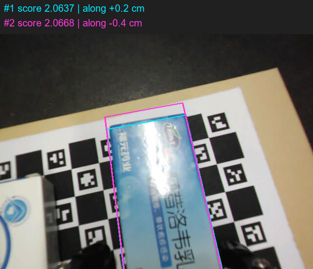
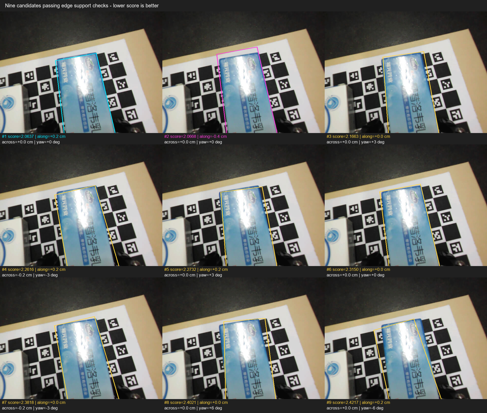

# 11 月 26 日抓取联调交接

## 当前状态

今天针对双药盒场景的近图定位失败完成了日志分析、候选框可视化和候选连续性选择。代码以 main 的 0b49277 为基线。实机最新失败轮次为 a52a9010da98432a9eb87d3625f74e60，细接近记录为 visual_approach_20261126_164556_72c5e5.json。

修改后，该轮七张近图按原顺序离线回放全部定位通过，其中三张通过上一张确认位置消除了候选歧义。尚无本次修改后的完整实机成功抓取记录。定位通过表示当前算法选出了位姿，真实盒心误差仍需现场或人工标注验证。

## 本轮实机为什么失败

现场在标定板上摆了两个药盒。初始药名识别、场景注册和预接近均成功。细接近执行了四次运动后，两次近图都因盒边候选歧义而退出。普通曝光 seq12 与半曝光 seq13 均收到完整照片，并通过 JPEG 检查。

末图中，目标药盒下端超出画面，夹爪遮住下方区域，包装表面存在反光。另一药盒在左侧局部可见。回放显示主要竞争候选都围绕目标药盒，现有证据不能认定算法切换到了左侧药盒。

seq12 有九个候选通过基本边缘支持检查。最低两个得分分别为 2.0637009144 和 2.0668276946，差约 0.0031，但沿药盒长方向的搜索偏移分别为 +0.2 cm 与 -0.4 cm，位置相差 0.6 cm。缺失的端部无法提供足够约束，两个框都能贴住相似的可见长边。

| 照片序号 | 基本检查后的候选数 | 修改前结果 | 修改后顺序回放 |
| --- | --- | --- | --- |
| seq7 | 14 | 通过 | 通过，最低边缘误差 |
| seq8 | 11 | 通过 | 通过，最低边缘误差 |
| seq9 | 14 | 通过 | 通过，最低边缘误差 |
| seq10 | 8 | 歧义退出 | 通过，位置连续性辅助 |
| seq11 | 10 | 通过 | 通过，最低边缘误差 |
| seq12 | 9 | 歧义退出 | 通过，位置连续性辅助 |
| seq13 | 6 | 歧义退出 | 通过，位置连续性辅助 |

候选数量本身不决定失败。成功图片同样可能有十几个候选。旧规则在最低分附近 0.12 内发现其他位置相差至少约 0.28 cm、或角度相差至少 5° 的候选时，判定无法可靠选择。

## 本次代码改动

### box_rim_geometry.py

refine_grounded_rim 增加可选参数 prior_pose，表示同一相机坐标系下前一张确认的药盒位姿。

1. 先按原来的可见边数量、边缘覆盖和方向条件筛选候选，再找最低边缘得分。
2. 如果没有原规则定义的歧义，照常选择最低分。
3. 如果出现歧义且传入 prior_pose，只在最低分加 0.12 范围内比较位置连续性。
4. 连续性代价为平移距离除以 0.28 cm，加上长轴方向角差除以 5°。代价越小越优，代价相同时用边缘得分排序。这两个除数是权重尺度。
5. 没有 prior_pose 的调用方保留原来的歧义处理。明显较差的图像候选不会因为接近旧位置而取代更好的候选。

### grasp_visual_observer.py

上一帧药盒位姿 last_object 存在上一帧相机坐标系中。先用 last_camera 转到机械臂基座坐标，再用当前相机位姿转入当前相机坐标，随后传给候选选择函数。第一张近图采用初始注册确认的药盒位姿作为参考。

本次保留原有初始位置附近的搜索范围，仅为歧义选择提供上一张确认位置。每次定位通过后继续更新 last_camera 与 last_object。该策略依据药盒在接近过程中保持静止的假设，若被夹爪碰动，旧位置可能产生偏向。

本次仅实现“前帧位置辅助”和“相近得分时选择连续候选”。按照现场要求，候选歧义时调整观察姿态的动作没有纳入本次实现。

### 诊断字段

近图记录 tracking 内增加以下字段。

| 字段 | 含义 |
| --- | --- |
| candidate_selection | lowest_edge_distance 或 previous_confirmed_pose_tiebreak |
| near_tied_candidate_count | 连续性辅助选择时，近最低分集合的候选数 |
| prior_translation_delta_cm | 被选位姿与参考位姿的平移差，单位 cm |

已有 mean_edge_distance_px 仍记录被选候选的边缘代价。平移差接近零只能说明与参考位置一致，不能证明实际精度为零。

## 本次验证

- 新增 test_rim_continuity.py 的三项测试，覆盖无参考时保留歧义、参考位置消除近分歧义，以及参考位置不能推翻明显更优图像证据。
- 三项现有板位姿测试通过。
- 收尾共运行 33 项测试全部通过，覆盖连续性、板位姿、主控、曝光协议、TCP 路径规划和接近策略。
- 以本轮原始注册和实际关节反馈启动 GraspVisualObserver，按七张照片的实际顺序逐张 estimate，七张全部通过。seq10、seq12、seq13 使用连续性辅助。
- 回放仅计算和读文件，没有连接机械臂或下发运动。它没有验证后续细接近路径、闭爪或返航。

## 今天已有的配套提交

这些内容在本次连续性修改前已经存在于 main，接手时应一并理解。

- 3cecabc 处理 K210 曝光读回，并调整收臂验收反馈。当前收臂拍照前后允许 1 号位置差 3 格、其余关节 5 格，并打印前后读数、差值和超限关节。
- 0b49277 为低位对齐增加受限水平路径搜索，相关实现位于 guarded_visual_approach.py、tcp_pose_planner.py。它处理的是运动可达性，与本次图像候选歧义属于不同阶段。
- 半曝光补拍已在实机末图日志中触发，但本轮仍存在几何歧义。因此曝光变化不能单独解决端部出画面的问题。

## YOLO 接入的讨论结论

本次查阅的是本地 yolo 分支里的 expv4s 实例分割实现。模型给每只盒子生成独立像素区域，OCR 将药名关联到目标区域，再用区域筛选轮廓或限制纹理匹配范围。该分支近景仍使用纹理匹配，与当前 main 的盒边测量实现不同。

YOLO 有望改善多盒目标关联、减少标定板背景干扰。它的分割边界也可能包含侧面或偏离精确盒面边缘，不能凭模型名称断言精度更高。后续适合评估“实例分割选择目标区域、盒边测量精修、连续性处理歧义”的组合。本次没有合入 yolo 分支。

## 下一位同学如何测试

电脑端仍使用原单次入口，先确认摄像头、SSH 转发和树莓派机械臂服务就绪。

```bat
.\.venv\Scripts\python.exe -X utf8 .\k210_camera\grasp_controller.py --config .\k210_camera\controller_pc_fixed_placement_trial.json --once continuity_1126_%RANDOM%_%RANDOM% --execute
```

先复现今天双药盒摆位，保留每步新图与关节反馈，检查 tracking.candidate_selection，比较选中框是否贴合实际药盒。若仍失败，优先根据完整错误区分图像定位与运动规划，记录 request_id、run_id 和失败阶段。实际药盒发生接触移动后，需要特别核对连续性参考是否仍可靠。

运行离线回归测试可使用以下命令。

```bat
.\.venv\Scripts\python.exe -B -m unittest discover -s k210_camera -p test_rim_continuity.py
.\.venv\Scripts\python.exe -B -m unittest discover -s k210_camera -p test_board_pose_inliers.py
```

## 附件

evidence 目录保存原图、两个最优候选叠加图、九候选分图、候选数字记录、失败日志和细接近记录。记录 JSON 中的绝对路径来自本机，其他电脑回放时需重定位原图和标定资料路径。候选搜索偏移是相对名义位姿的偏移，不能直接当成真实盒心误差。




